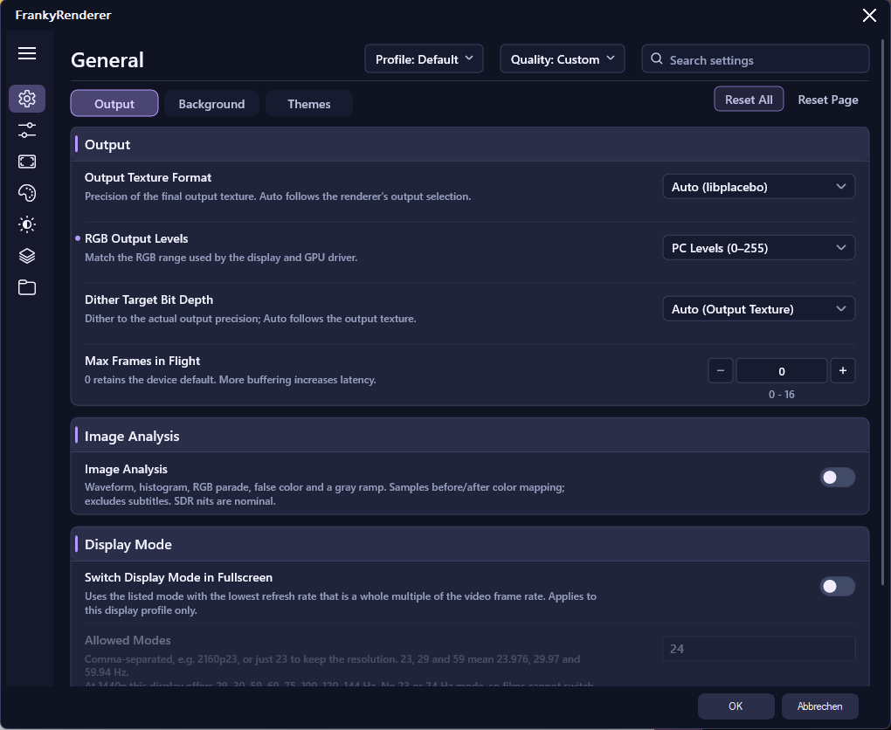
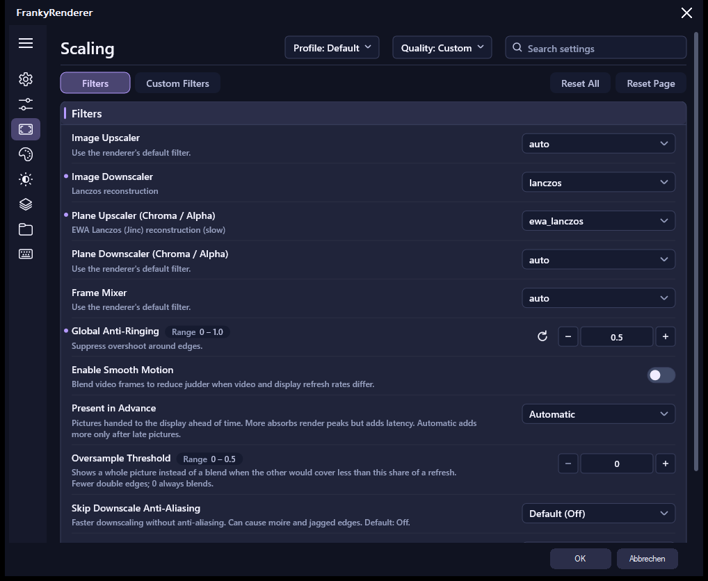
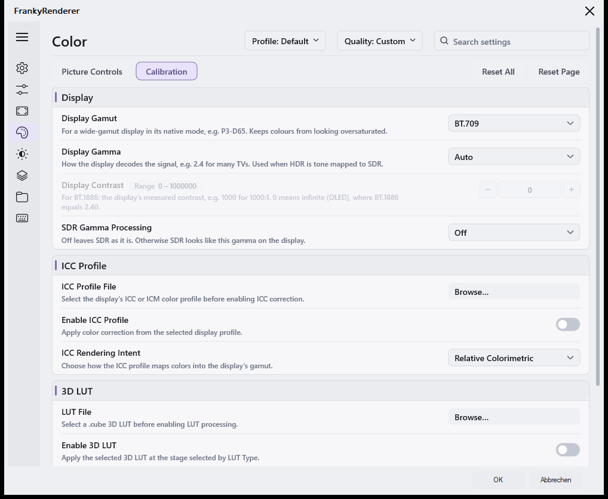
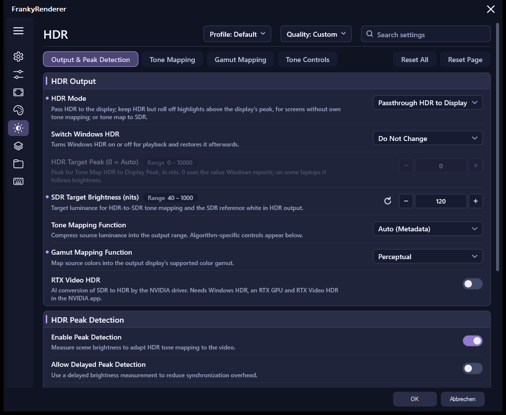
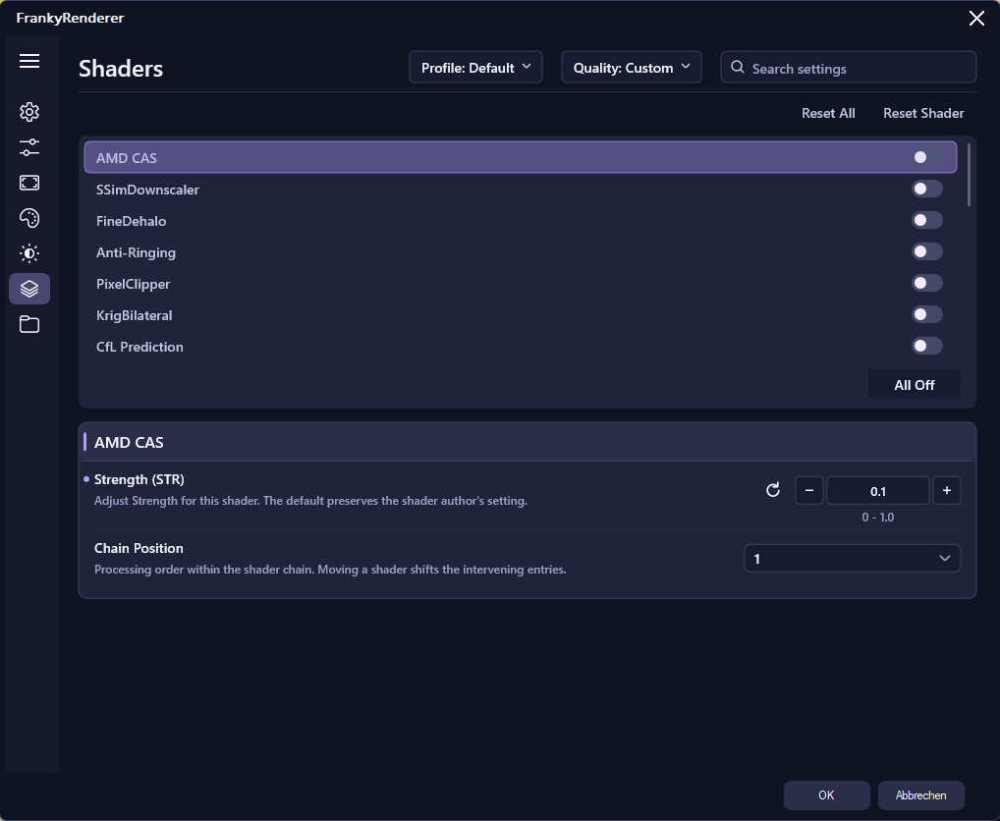
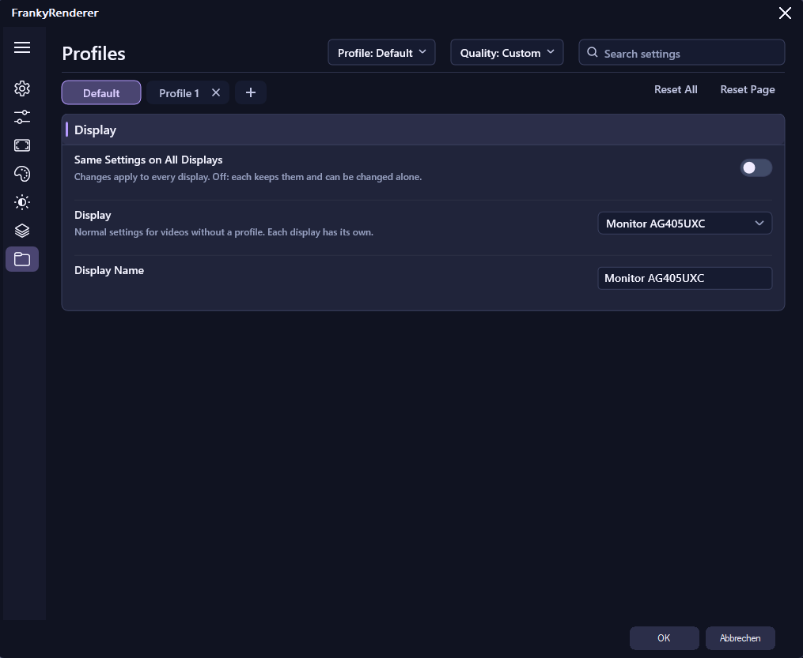

# FrankyRenderer

I've been using the madVR renderer for many years now. Unfortunately, updates have become quite rare, with what feels like only one update per year.

Meanwhile, MPC Video Renderer is still being actively developed, and libplacebo, which also continues to receive regular updates, has built a very good reputation for its image processing capabilities.

So I thought: Why not take the core functionality of MPC Video Renderer, build my own renderer around it, and let libplacebo handle the image processing?

And that's exactly what I did.

I decided to call my renderer Franky, inspired by Frankenstein, who pieced together different body parts to create something entirely new. Since my renderer is also built by combining different components into something new, I thought the name was quite fitting.

It's still a work in progress, so there are probably quite a few bugs I haven't discovered yet, especially considering the number of available settings.

Questions, ideas and general feedback are welcome. Please use [Issues](https://github.com/mryx007/FrankyRenderer/issues) for bug reports.

## Screenshots

<table>
  <tr>
    <td align="center"><a href="https://raw.githubusercontent.com/mryx007/FrankyRenderer/main/docs/screenshots/general.png"></a><br><sub>General</sub></td>
    <td align="center"><a href="https://raw.githubusercontent.com/mryx007/FrankyRenderer/main/docs/screenshots/scaling.png"></a><br><sub>Scaling</sub></td>
    <td align="center"><a href="https://raw.githubusercontent.com/mryx007/FrankyRenderer/main/docs/screenshots/color-calibration.png"></a><br><sub>Color calibration (light theme)</sub></td>
  </tr>
  <tr>
    <td align="center"><a href="https://raw.githubusercontent.com/mryx007/FrankyRenderer/main/docs/screenshots/hdr.png"></a><br><sub>HDR</sub></td>
    <td align="center"><a href="https://raw.githubusercontent.com/mryx007/FrankyRenderer/main/docs/screenshots/shaders.png"></a><br><sub>Shaders</sub></td>
    <td align="center"><a href="https://raw.githubusercontent.com/mryx007/FrankyRenderer/main/docs/screenshots/profiles.png"></a><br><sub>Profiles</sub></td>
  </tr>
</table>

Click a preview to open the full-size image. The screenshots show example settings, not recommended presets.

## Features

<details>
<summary>Show features</summary>

### Video input and output

- DirectShow video rendering for Windows x64, with libplacebo image processing and Direct3D 11 / DXGI presentation.
- Native D3D11 decoder textures and CPU video input, with the active transfer path shown in the statistics overlay.
- Support for 8-, 10-, 12- and 16-bit input layouts, including NV12, P010/P012/P016, planar YUV, packed YUV, RGB and grayscale formats. Native GPU input depends on the decoder's texture format and device capabilities.
- Selectable output texture format: automatic, 8-bit integer, preferred 10-bit integer or preferred 16-bit float.
- Configurable RGB output levels, dither target bit depth and maximum frames in flight.
- Display mode switching in fullscreen like madVR: each display has its own list of allowed modes (for example 2160p23, 2160p24, 2160p50, 2160p60), the original mode is restored when leaving fullscreen or stopping, and playback can pause while the TV resynchronises.
- D3D11 subtitle composition through compatible host callbacks, and XySubFilter support.

### Dolby Vision and HDR metadata

- Automatic Dolby Vision Profile 7 FEL/MEL processing for local files, including UHD Blu-ray BDMV `.m2ts` clips and `.mpls` playlists, integrated into the renderer without an additional DirectShow filter. The existing splitter and base-layer decoder remain in use.
- Dolby Vision Profile 5 and 8, HDR10 and HDR10+ metadata (including the HDR10+ tone-mapping curve) is applied even when the player's decoder does not pass it on.

### Scaling and Smooth Motion

- Separate image upscaling, image downscaling, chroma/alpha upscaling and chroma/alpha downscaling filters.
- EWA Lanczos / Jinc, EWA Lanczos Sharp, Lanczos, Spline16/36/64, Mitchell, Bicubic, Robidoux and additional libplacebo filters.
- Custom filter editor with a starting filter, kernel, window, radius, clamp, blur, taper, anti-ringing, kernel/window parameters and EWA mode.
- Global anti-ringing strength and configurable downscaling anti-aliasing behavior.
- Smooth Motion through temporal frame mixing, with selectable and customizable frame mixer filters (including Clamped Mitchell), "Present in Advance" (1 to 4 refreshes or automatic, like madVR) and an "Oversample Threshold" for fewer double edges on motion.
- Optional NVIDIA RTX Video Super Resolution through the driver, without an additional NVIDIA runtime DLL or helper process. Enable Super Resolution and choose quality in the NVIDIA app or Control Panel. Supports SDR and HDR10/PQ with 8-/10-bit processing; unsupported formats and native-size/downscaled output keep normal libplacebo scaling.

### Image processing

- Debanding with adjustable iterations, threshold, radius and grain.
- Adaptive Sharpen with adjustable strength.
- Bwdif and Yadif deinterlacing with temporal references, automatic field order and manual top/bottom-field overrides.
- Blue-noise, ordered, random and error diffusion dithering, with optional temporal dithering.
- Image analysis overlay: waveform, histogram, RGB parade, false colour and a gray ramp, sampled before and after colour mapping.

### HDR and color mapping

- Three HDR modes: Passthrough HDR to Display, Tone Map HDR to Display Peak (keeps HDR output but rolls off highlights above the display's peak, for monitors and laptops that do not tone map themselves) and Tone Map HDR to SDR.
- Native NVIDIA HDR10 passthrough sends HDR metadata to the display while leaving the Windows HDR setting off. Moving the video between displays updates the HDR output, including while paused, and restores the previous display's state. AMD native HDR output is not implemented.
- RTX Video HDR for SDR videos (NVIDIA RTX GPU, Windows HDR on).
- "Switch Windows HDR": turns Windows HDR on for HDR videos and off for SDR videos (always or only in fullscreen) and restores it afterwards.
- Tone mapping functions including Spline, BT.2390, BT.2446A, Reinhard, Mobius, Hable and ST 2094 curves.
- Adjustable SDR target brightness, HDR target peak and HDR peak override.
- HDR peak detection with smoothing, scene-change thresholds, percentile selection, black cutoff and delayed peak detection control.
- Detailed tone curve controls for knee adaptation, Spline slope/contrast and other function-specific parameters.
- Local contrast recovery with adjustable strength and smoothness.
- Perceptual, relative/absolute colorimetric, softclip, saturation and additional gamut mapping methods.
- Gamut compression controls, internal LUT resolution and optional tricubic gamut interpolation.
- Separate HDR Shadows, Midtones and Highlights controls, each with exposure, contrast and saturation adjustments.
- Inverse tone mapping, gamut expansion, metadata selection and clipping/LUT visualization controls.

### Color adjustment and calibration

- Brightness, contrast, saturation, gamma, hue and color temperature controls.
- Display gamut (BT.709, SMPTE C, EBU / PAL, BT.2020, DCI-P3, P3-D65) for wide-gamut displays in their native mode.
- Display gamma (Auto, 1.80 to 2.80 in steps of 0.05, or BT.1886 with the display's measured contrast) for HDR tone mapped to SDR, and SDR gamma processing to make SDR look like a chosen gamma on that display.
- SDR ICC profile support with selectable rendering intent.
- Custom `.cube` LUT loading and LUT interpretation controls, or "LUT from Video Folder" to use a `.cube` file next to the video.

### Shader chain

- 23 bundled mpv-compatible GLSL shaders, with original authorship and license notices preserved.
- Neural/adaptive upscaling options: FSRCNNX 2x, AiUpscale Photo 2x, RAVU Zoom, RAVU Zoom R3 and RAVU Zoom AR R3.
- Animation-oriented upscaling: Anime4K CNN 2x M, ArtCNN C4F16 and CuNNy 2x12 DS.
- Chroma reconstruction: KrigBilateral and CfL Prediction.
- Sharpening, detail and local contrast: AMD CAS, Guided Detail Enhance and Clarity.
- Edge cleanup: FineDehalo, Anti-Ringing and PixelClipper.
- Denoising and debanding: NLMeans, Bilateral Denoise, Chroma Denoise, hdeband and neo-f3kdb.
- Detail-aware downscaling: SSimDownscaler and DPID.
- Your own mpv shaders (`.glsl` / `.hook`, packs such as Anime4K) from the `shaders\Custom` folder.
- Per-shader parameters (on/off switches where a parameter only knows 0 or 1) and an automatic or manual processing order.

### Black bars and zoom

- Automatic detection of hardcoded black bars from video pixels; end credits are not mistaken for black bars.
- Crop and zoom controls to fit active content or fill the output.
- Adjustable detection threshold and switching delay.
- Protection for detected subtitle content in the black bars.

### Profiles and displays

- Profiles: videos from folders you choose get their own settings, for example a different upscaler for anime. A profile only stores what differs from the normal settings and can be limited to certain displays.
- Separate normal settings for each display, with editable device names, or "Same Settings on All Displays" to set every display at once.
- Import and export all saved settings in one INI backup, including disconnected displays and custom names.

### Settings and diagnostics

- Settings menu drawn with Direct2D and DirectWrite, with themes and translations (English, German, Chinese Simplified; more on Weblate).
- The player stays usable while the menu is open: pause, seek or switch to fullscreen and compare settings live. OK keeps the changes, Cancel restores the opening values.
- Quality presets (Fast / Default / High Quality), "Measure this PC" to pick the best settings for the GPU, and "Custom" to return to your own settings.
- Search across settings, readable descriptions, explicit default values and ranges, Reset Page and Reset All.
- Keyboard shortcuts: any setting can get a key on the Shortcuts page.
- "Remember Last Page": the settings window reopens where it was closed.
- Configurable background color, transparency and rendering quality/performance options.
- Ctrl+J statistics grouped into Display, Video, Processing and Performance, with render time against the time available per picture, drop counters, Dolby Vision status and custom scalers in detail. "Statistics in Video Area" places them on the picture instead of in the black bars.
- Diagnostic Log and Save Report for bug reports.
- Persistent shader cache for reusing compiled processing work across playback sessions.

</details>

## Installation and system requirements

Tested on **Windows 11 x64**. Windows 10 x64 is expected to work, but I have not tested it because I do not have a Windows 10 system available.

- **MPC-BE:** Use MPC-BE 1.9.3 or newer and select **FrankyRenderer** in the video renderer settings.
- **PotPlayer:** Use PotPlayer 261030 Beta 64-bit or a newer build with native FrankyRenderer support. Select **FrankyRenderer** in the video renderer settings.
- **MPC-HC:** Use MPC-HC 2.8.5.14 or newer and select **FrankyRenderer** in the video renderer settings.

Keep the installation folder in place. To remove the renderer, run `Uninstall.cmd`.

**Settings backup:** **Export** saves all display profiles to an INI file; **Import** restores them. Keep external ICC and LUT files separately.

## Downloads

- **[Stable release](https://github.com/mryx007/FrankyRenderer/releases/latest)** — recommended for normal use.
- **[Nightly test builds](https://github.com/mryx007/FrankyRenderer-Nightly/releases/latest)** — fixes awaiting user feedback.
- **[MPC-BE 1.9.3](https://github.com/Aleksoid1978/MPC-BE/releases/latest)** — official release with native FrankyRenderer selection.
- **[MPC-HC](https://github.com/clsid2/mpc-hc/releases/)** — official release with native FrankyRenderer selection.
- **[PotPlayer Beta 64-bit](https://t1.daumcdn.net/potplayer/beta/PotPlayerSetup64.exe)** — player build with native FrankyRenderer selection.

The same x64 ZIP supports both MPC-BE and PotPlayer builds with native FrankyRenderer selection.

## Translations

The settings menu is translated on [Weblate](https://hosted.weblate.org/projects/frankyrenderer/). Anyone can help there, no Git knowledge needed. New translations ship with the Nightly builds first.

[](https://hosted.weblate.org/projects/frankyrenderer/)

## Source code and dependency sources

The renderer source and build instructions are available in this repository. [Dependency sources](docs/dependency-sources.md) lists the exact official source packages, build recipes and SHA-256 checksums corresponding to the bundled runtime libraries.

## Project layout

- `src` - renderer, settings, UI, shaders, tests and tools in [separate folders](src/README.md); required DirectShow compatibility code remains under `src/DirectShow`.
- `dist` - locally generated installable package, excluded from Git.
- `LICENSE` and `THIRD_PARTY.md` - licensing and attribution.

## Build

Requires Windows x64, Visual Studio 2022 or later with C++ tools, a Windows SDK with `fxc.exe`, and Python 3.14 x64.

Follow the [build guide](docs/build.md) to prepare dependencies, then run these commands from the repository root in a Visual Studio x64 developer shell:

```powershell
.\build.cmd
python src/Tools/package_release.py --output releases/local-packages
```

This builds the shared native renderer and creates one ZIP without installing it. For automated builds and releases, see [GitHub automation](docs/automation.md).

## Code formatting

The project's C++ sources use the checked-in `.clang-format` configuration with four-space indentation and expanded control flow. Third-party sources under `src/DirectShow` retain their upstream formatting.

```powershell
python -m pip install -r requirements-dev.txt
python src/Tools/format_code.py
python src/Tools/format_code.py --check
```

The formatting script uses clang-format 21.1.8 and only processes tracked project C++ files in `src/Renderer`, `src/Settings`, `src/UI`, `src/DolbyVision` and `src/Tests`.

## License and credits

FrankyRenderer is distributed under **GPL-3.0-or-later**, due to its MPC Video Renderer code reuse. See [LICENSE](LICENSE) and [THIRD_PARTY.md](THIRD_PARTY.md). Existing copyright notices and individual shader licenses are preserved. FrankyRenderer is an independent project and is not an official MPC Video Renderer, libplacebo, mpv or PotPlayer release.

Image processing is powered by [libplacebo](https://github.com/haasn/libplacebo), the rendering library also used by mpv. It provides scaling, HDR tone mapping, color management and other image processing features.
