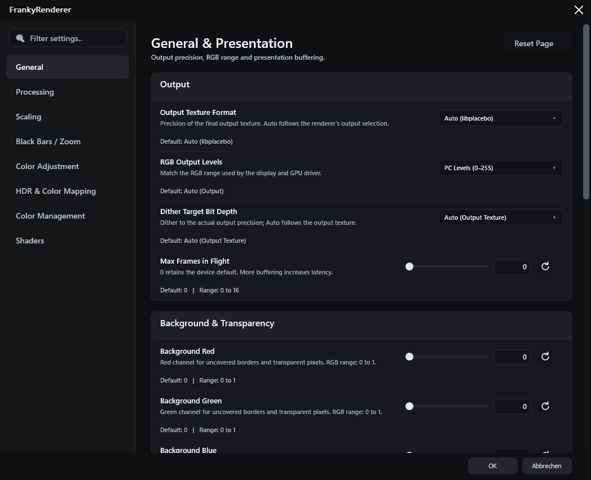
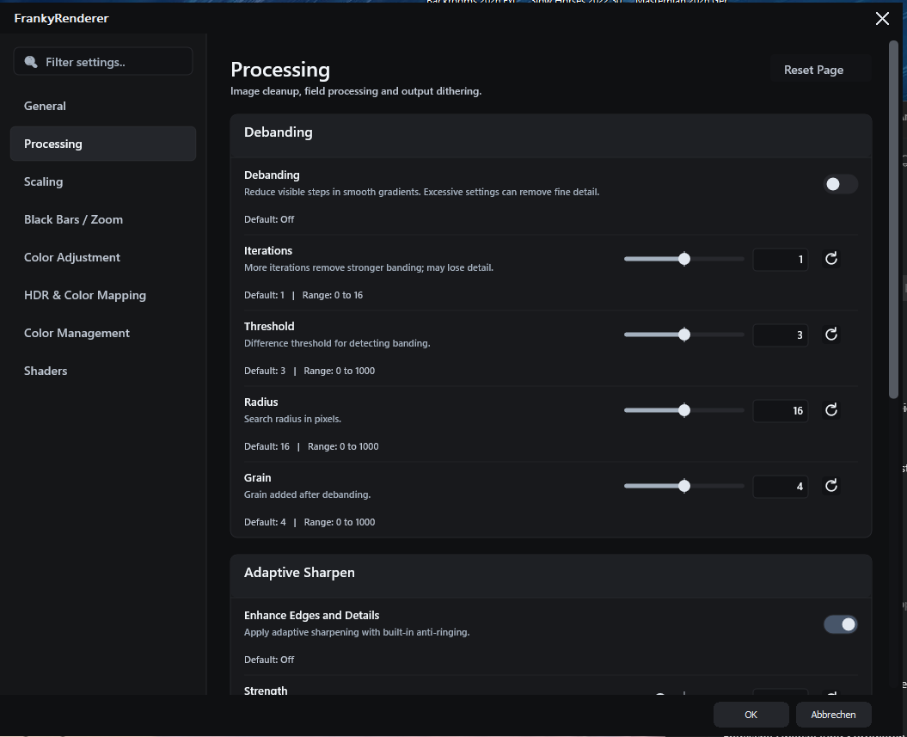
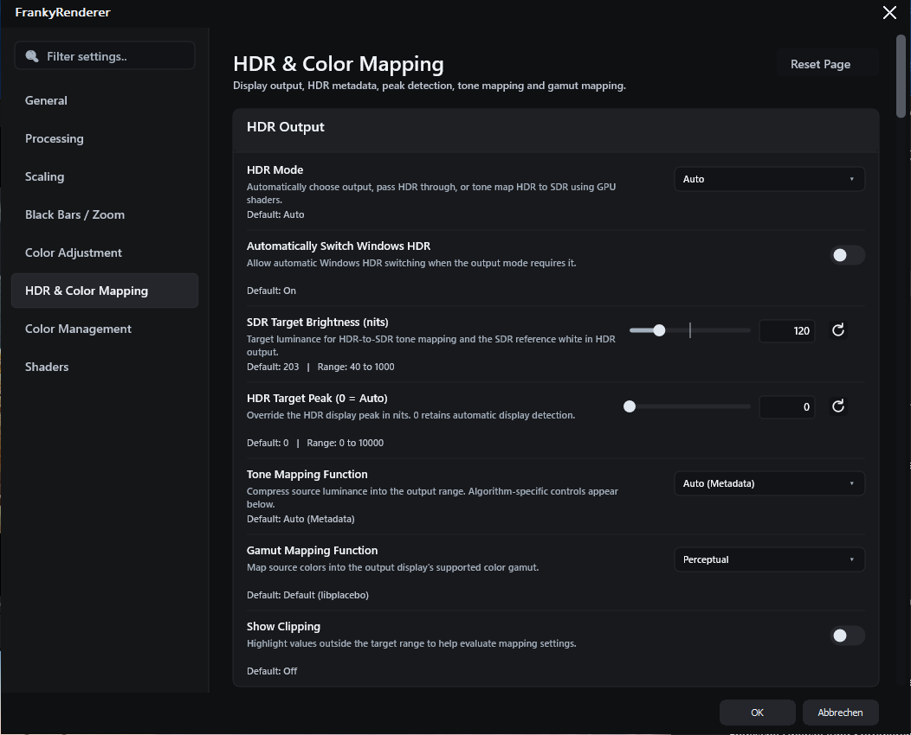
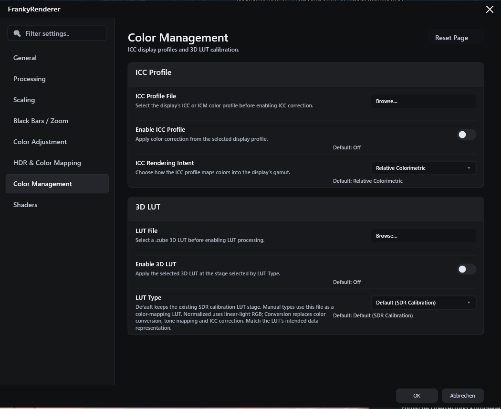
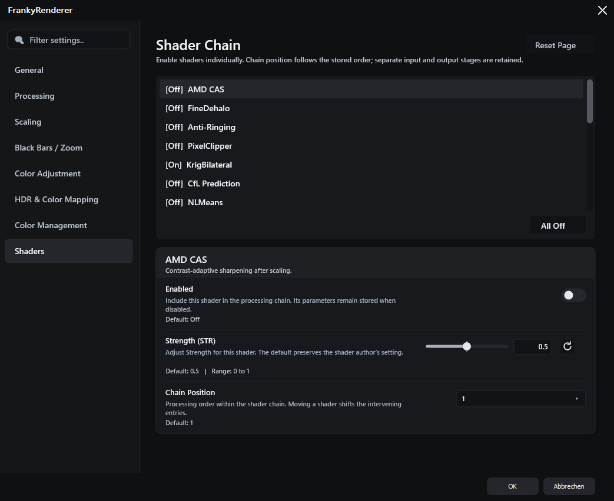

# FrankyRenderer

A standalone Windows x64 DirectShow video renderer, based on MPC Video Renderer components, using **libplacebo** for image processing and **Direct3D 11 / DXGI** for presentation.

FrankyRenderer is a development project. Synthetic GPU and DirectShow regression tests cover its main paths; compatibility and image quality still depend on the player, decoder, graphics driver and display.

## Screenshots

General and presentation settings:



<details>
<summary>Processing — debanding, sharpening, deinterlacing and dithering</summary>



</details>

<details>
<summary>HDR and Color Mapping</summary>



</details>

<details>
<summary>Color Management — ICC profiles and 3D LUTs</summary>



</details>

<details>
<summary>Shader Chain</summary>



</details>

The screenshots show example settings, not recommended presets.

## Features

### Video input and output

- DirectShow video rendering for Windows x64, with libplacebo image processing and Direct3D 11 / DXGI presentation.
- Native D3D11 decoder textures and CPU video input, with the active transfer path shown in the statistics overlay.
- Support for 8-, 10-, 12- and 16-bit input layouts, including NV12, P010/P012/P016, planar YUV, packed YUV, RGB and grayscale formats. Native GPU input depends on the decoder's texture format and device capabilities.
- Selectable output texture format: automatic, 8-bit integer, preferred 10-bit integer or preferred 16-bit float.
- Configurable RGB output levels, dither target bit depth and maximum frames in flight.
- D3D11 subtitle composition through compatible host callbacks.

### Scaling and Smooth Motion

- Separate image upscaling, image downscaling, chroma/alpha upscaling and chroma/alpha downscaling filters.
- EWA Lanczos / Jinc, EWA Lanczos Sharp, Lanczos, Spline16/36/64, Mitchell, Bicubic, Robidoux and additional libplacebo filters.
- Custom filter editor with a starting filter, kernel, window, radius, clamp, blur, taper, anti-ringing, kernel/window parameters and EWA mode.
- Global anti-ringing strength and configurable downscaling anti-aliasing behavior.
- Smooth Motion through temporal frame mixing, with selectable and customizable frame mixer filters.

### Image processing

- Debanding with adjustable iterations, threshold, radius and grain.
- Adaptive Sharpen with adjustable strength.
- Bwdif and Yadif deinterlacing with temporal references, automatic field order and manual top/bottom-field overrides.
- Blue-noise, ordered and random dithering, with optional temporal dithering.

### HDR and color mapping

- Automatic HDR handling, HDR passthrough and GPU tone mapping from HDR to SDR.
- Tone mapping functions including Spline, BT.2390, BT.2446A, Reinhard, Mobius, Hable and ST 2094 curves.
- Adjustable SDR target brightness and HDR peak override.
- HDR peak detection with smoothing, scene-change thresholds, percentile selection, black cutoff and delayed peak detection control.
- Detailed tone curve controls for knee adaptation, Spline slope/contrast and other function-specific parameters.
- Local contrast recovery with adjustable strength and smoothness.
- Perceptual, relative/absolute colorimetric, softclip, saturation and additional gamut mapping methods.
- Gamut compression controls, internal LUT resolution and optional tricubic gamut interpolation.
- Separate HDR Shadows, Midtones and Highlights controls, each with exposure, contrast and saturation adjustments.
- Inverse tone mapping, gamut expansion, metadata selection and clipping/LUT visualization controls.

### Color adjustment and management

- Brightness, contrast, saturation, gamma, hue and color temperature controls.
- SDR ICC profile support with selectable rendering intent.
- Custom `.cube` LUT loading and LUT interpretation controls.

### Shader chain

- 21 bundled mpv-compatible GLSL shaders from the PlayKit collection, with original authorship and license notices preserved.
- Neural/adaptive upscaling options: FSRCNNX 2x, AiUpscale Photo 2x and RAVU Zoom.
- Animation-oriented upscaling: Anime4K CNN 2x M, ArtCNN C4F16 and CuNNy 2x12 DS.
- Chroma reconstruction: KrigBilateral and CfL Prediction.
- Sharpening, detail and local contrast: AMD CAS, Guided Detail Enhance and Clarity.
- Edge cleanup: FineDehalo, Anti-Ringing and PixelClipper.
- Denoising and debanding: NLMeans, Bilateral Denoise, Chroma Denoise, hdeband and neo-f3kdb.
- Detail-aware downscaling: SSimDownscaler and DPID.
- Per-shader parameters, configurable processing order and double-click enable/disable controls.

### Black bars and zoom

- Automatic detection of hardcoded black bars from video pixels.
- Crop and zoom controls to fit active content or fill the output.
- Adjustable detection threshold, switching delay and stable zoom behavior.
- Protection for detected subtitle content in the black bars.

### Settings, presentation and diagnostics

- Native dark settings interface drawn with Direct2D and DirectWrite, with English sections for General, Processing, Scaling, Black Bars / Zoom, Color Adjustment, Color Management, HDR and Color Mapping, and Shaders.
- Search across settings, scrollable pages, readable descriptions and explicit default values and ranges.
- Compact shader list with double-click enable/disable and a parameter editor for the selected shader.
- Live settings preview: valid changes appear immediately; OK keeps them and Cancel restores the dialog's opening values.
- Numeric entry, fine adjustment steps, reset controls and contextual descriptions.
- Configurable background color, transparency and rendering quality/performance options.
- PotPlayer fullscreen playlist-transition handling.
- Ctrl+J statistics with display/video information, active processing settings, frame counters, presentation timing and CPU/GPU render timings.
- Persistent shader cache for reusing compiled processing work across playback sessions.

Some HDR metadata is decoder-dependent. Missing metadata is not reconstructed from filenames. Dolby Vision support relies on metadata provided by the decoder; this is not Dolby Vision HDMI tunneling or FEL reconstruction.

## PotPlayer installation

> **Before installing:** uninstall or unregister the original **MPC Video Renderer** first. FrankyRenderer currently uses the same CLSID for PotPlayer compatibility, so both cannot be registered at the same time. A dedicated FrankyRenderer CLSID exists, but PotPlayer does not yet offer native selection through it. Uninstall the renderer itself, not MPC-HC or MPC-BE.

Download the Windows x64 ZIP from [Releases](https://github.com/mryx007/FrankyRenderer/releases), extract it to a permanent directory, then follow the installation steps below. The ZIP includes the renderer, required runtime DLLs, shaders and installation/removal scripts; no compilation is required to test a release.

For a local build, run `python src/package.py` to create the complete installable package in `dist`. Its displayed filter name is **FrankyRenderer**; `PlaceboRenderer.ax` remains the internal binary filename for compatibility.

1. Keep the extracted package directory at a permanent location and close PotPlayer.
2. Run `Installieren.cmd` inside the extracted package (or `dist` for a local build), or run `.\setup.ps1 -Action Install` from that directory. Windows requests administrator permission for COM registration.
3. In PotPlayer, select **MPC Video Renderer** under Video Renderer. This is PotPlayer's fixed menu label; the loaded filter is FrankyRenderer.
4. Open the filter's settings to configure it.

FrankyRenderer currently uses the MPC Video Renderer CLSID for PotPlayer discovery. It cannot occupy that registration alongside the original MPC Video Renderer. The installer refuses to overwrite a registration pointing elsewhere. Existing madVR registration is separate.

Do not move or delete the installed package directory. Uninstall using its removal launcher or `setup.ps1 -Action Remove`.

## Project layout

- `src` - all build sources, shaders, tests and scripts; required DirectShow compatibility code is included under `src/DirectShow` with its original notices.
- `dist` - locally generated installable package, excluded from Git.
- `LICENSE` and `THIRD_PARTY.md` - licensing and attribution.

## Build

Requirements: Windows x64, Visual Studio 2022 or later with Desktop development with C++, a Windows SDK containing `fxc.exe`, and **Python 3.14+**.

From the repository root:

```powershell
python -m pip install -r requirements.txt
python src/fetch_dependencies.py
python src/prepare_sdk.py
.\build.cmd
python src/package.py
```

Dependencies are restored locally from official MSYS2 packages using the checked-in SHA256 lock file. The scripts locate Visual Studio through `vswhere`; no personal SDK paths are required. Build output is `src/build/bin/PlaceboRenderer.ax` and its adjacent runtime DLLs and shaders.

All build sources are under `src`, including the required compatibility interfaces and DirectShow BaseClasses in `src/DirectShow`. FrankyRenderer uses its own libplacebo/D3D11 rendering path.

## Tests

```powershell
.\src\build_tests.cmd
python src/run_tests.py
python src/run_tests.py --live-ui
.\src\build_sdr_target.cmd
python src/run_tests.py --sdr-target
.\src\build_sdr_present.cmd
python src/run_tests.py --sdr-present
.\src\build_tonal.cmd
python src/run_tests.py --tonal
```

Tests use disposable settings roots and do not inherit the normal user's Auto HDR setting. The default test covers DirectShow, menus and GPU readback. `--live-ui` separately exercises immediate changes and Cancel/OK behavior. Targeted tests cover the SDR luminance boundary, the actual 10-bit presentation signal across 203 nits, and HDR tonal controls. These tests do not replace real playback and display calibration.

The settings and shader-cache storage names from the earlier development build are retained, so upgrading does not discard existing settings.

## License and credits

FrankyRenderer is distributed under **GPL-3.0-or-later**, due to its MPC Video Renderer code reuse. See [LICENSE](LICENSE) and [THIRD_PARTY.md](THIRD_PARTY.md). Existing copyright notices and individual shader licenses are preserved. FrankyRenderer is an independent project and is not an official MPC Video Renderer, libplacebo, mpv or PotPlayer release.
