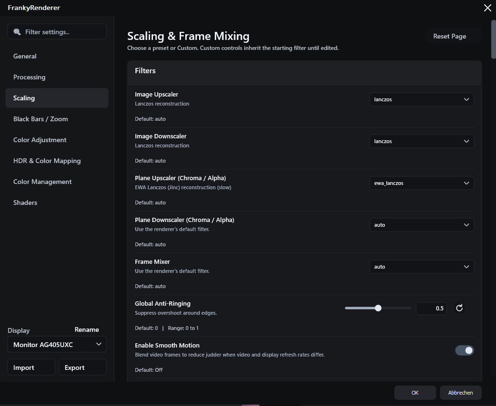
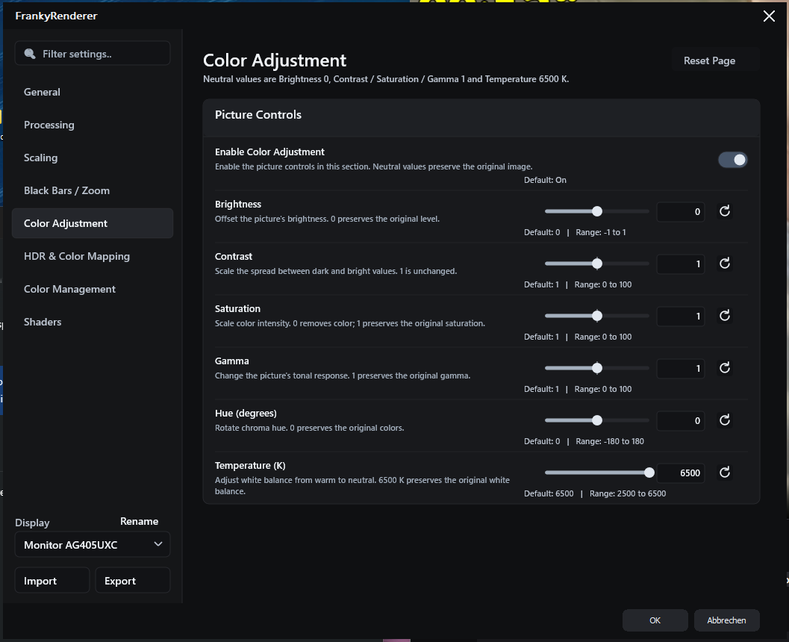

# FrankyRenderer

I've been using the madVR renderer for many years now. Unfortunately, updates have become quite rare, with what feels like only one update per year.

Meanwhile, MPC Video Renderer is still being actively developed, and libplacebo, which also continues to receive regular updates, has built a very good reputation for its image processing capabilities.

So I thought: Why not take the core functionality of MPC Video Renderer, build my own renderer around it, and let libplacebo handle the image processing?

And that's exactly what I did.

I decided to call my renderer Franky, inspired by Frankenstein, who pieced together different body parts to create something entirely new. Since my renderer is also built by combining different components into something new, I thought the name was quite fitting.

It's still a work in progress, so there are probably quite a few bugs I haven't discovered yet, especially considering the number of available settings.

Questions, ideas and general feedback are welcome in [Discussions](https://github.com/mryx007/FrankyRenderer/discussions). Please use [Issues](https://github.com/mryx007/FrankyRenderer/issues) for bug reports.

## Screenshots

<table>
  <tr>
    <td align="center"><a href="https://raw.githubusercontent.com/mryx007/FrankyRenderer/main/docs/screenshots/general.png"></a><br><sub>General &amp; Presentation</sub></td>
    <td align="center"><a href="https://raw.githubusercontent.com/mryx007/FrankyRenderer/main/docs/screenshots/scaling.png"></a><br><sub>Scaling &amp; Frame Mixing</sub></td>
    <td align="center"><a href="https://raw.githubusercontent.com/mryx007/FrankyRenderer/main/docs/screenshots/color-adjustment.png"></a><br><sub>Color Adjustment</sub></td>
  </tr>
  <tr>
    <td align="center"><a href="https://raw.githubusercontent.com/mryx007/FrankyRenderer/main/docs/screenshots/hdr-color-mapping.png"></a><br><sub>HDR &amp; Color Mapping</sub></td>
    <td align="center"><a href="https://raw.githubusercontent.com/mryx007/FrankyRenderer/main/docs/screenshots/color-management.png"></a><br><sub>Color Management</sub></td>
    <td align="center"><a href="https://raw.githubusercontent.com/mryx007/FrankyRenderer/main/docs/screenshots/shaders.png"></a><br><sub>Shader Chain</sub></td>
  </tr>
</table>

Click a preview to open the full-size image. The screenshots show example settings, not recommended presets.

## Features

<details>
<summary>Show features</summary>

### Video input and output

- DirectShow video rendering for Windows x64, with libplacebo image processing and Direct3D 11 / DXGI presentation.
- Native D3D11 decoder textures and CPU video input, with the active transfer path shown in the statistics overlay.
- Support for 8-, 10-, 12- and 16-bit input layouts, including NV12, P010/P012/P016, planar YUV, packed YUV, RGB and grayscale formats. Native GPU input depends on the decoder's texture format and device capabilities.
- Selectable output texture format: automatic, 8-bit integer, preferred 10-bit integer or preferred 16-bit float.
- Configurable RGB output levels, dither target bit depth and maximum frames in flight.
- D3D11 subtitle composition through compatible host callbacks.
- Automatic Dolby Vision Profile 7 FEL/MEL processing for supported local progressive files, integrated into the renderer without an additional DirectShow filter. The existing splitter and base-layer decoder remain in use; enhancement data is read from the same local file.

### Scaling and Smooth Motion

- Separate image upscaling, image downscaling, chroma/alpha upscaling and chroma/alpha downscaling filters.
- EWA Lanczos / Jinc, EWA Lanczos Sharp, Lanczos, Spline16/36/64, Mitchell, Bicubic, Robidoux and additional libplacebo filters.
- Custom filter editor with a starting filter, kernel, window, radius, clamp, blur, taper, anti-ringing, kernel/window parameters and EWA mode.
- Global anti-ringing strength and configurable downscaling anti-aliasing behavior.
- Smooth Motion through temporal frame mixing, with selectable and customizable frame mixer filters.
- Optional NVIDIA RTX Video Super Resolution through the driver, without an additional NVIDIA runtime DLL or helper process. Enable Super Resolution and choose quality in the NVIDIA app or Control Panel. Processed source images are cached before Smooth Motion; subtitles and final color processing follow afterward. Supports SDR and HDR10/PQ with 8-/10-bit processing; unsupported formats and native-size/downscaled output keep normal libplacebo scaling. Statistics report the driver request, not independently confirmed AI activity. Dolby Vision, HLG, linear, rotated and alpha-bearing input use normal scaling.

### Image processing

- Debanding with adjustable iterations, threshold, radius and grain.
- Adaptive Sharpen with adjustable strength.
- Bwdif and Yadif deinterlacing with temporal references, automatic field order and manual top/bottom-field overrides.
- Blue-noise, ordered and random dithering, with optional temporal dithering.

### HDR and color mapping

- Two HDR modes: Passthrough HDR to Display and Tone Map HDR to SDR.
- Native NVIDIA HDR10 passthrough sends HDR metadata to the display while leaving the Windows HDR setting off. Moving the video between displays updates the HDR output, including while paused, and restores the previous display's state. This driver path has been tested on NVIDIA hardware; AMD native HDR output is not implemented.
- A Clipping Protection switch for HDR-to-SDR tone mapping.
- Tone mapping functions including Spline, BT.2390, BT.2446A, Reinhard, Mobius, Hable and ST 2094 curves.
- Adjustable SDR target brightness and HDR peak override.
- HDR peak detection with smoothing, scene-change thresholds, percentile selection, black cutoff and delayed peak detection control.
- Detailed tone curve controls for knee adaptation, Spline slope/contrast and other function-specific parameters.
- Local contrast recovery with adjustable strength and smoothness.
- Perceptual, relative/absolute colorimetric, softclip, saturation and additional gamut mapping methods.
- Gamut compression controls, internal LUT resolution and optional tricubic gamut interpolation.
- Separate HDR Shadows, Midtones and Highlights controls, each with exposure, contrast and saturation adjustments.
- Inverse tone mapping, gamut expansion, metadata selection and clipping/LUT visualization controls.

### Color adjustment and management

- Brightness, contrast, saturation, gamma, hue and color temperature controls.
- SDR ICC profile support with selectable rendering intent.
- Custom `.cube` LUT loading and LUT interpretation controls.

### Shader chain

- 21 bundled mpv-compatible GLSL shaders from the PlayKit collection, with original authorship and license notices preserved.
- Neural/adaptive upscaling options: FSRCNNX 2x, AiUpscale Photo 2x and RAVU Zoom.
- Animation-oriented upscaling: Anime4K CNN 2x M, ArtCNN C4F16 and CuNNy 2x12 DS.
- Chroma reconstruction: KrigBilateral and CfL Prediction.
- Sharpening, detail and local contrast: AMD CAS, Guided Detail Enhance and Clarity.
- Edge cleanup: FineDehalo, Anti-Ringing and PixelClipper.
- Denoising and debanding: NLMeans, Bilateral Denoise, Chroma Denoise, hdeband and neo-f3kdb.
- Detail-aware downscaling: SSimDownscaler and DPID.
- Per-shader parameters, configurable processing order and double-click enable/disable controls.

### Black bars and zoom

- Automatic detection of hardcoded black bars from video pixels.
- Crop and zoom controls to fit active content or fill the output.
- Adjustable detection threshold, switching delay and stable zoom behavior.
- Protection for detected subtitle content in the black bars.

### Settings, presentation and diagnostics

- Native dark settings interface drawn with Direct2D and DirectWrite, with English sections for General, Processing, Scaling, Black Bars / Zoom, Color Adjustment, Color Management, HDR and Color Mapping, and Shaders.
- Search across settings, scrollable pages, readable descriptions and explicit default values and ranges.
- Compact shader list with double-click enable/disable and a parameter editor for the selected shader.
- Live settings preview: valid changes appear immediately; OK keeps them and Cancel restores the dialog's opening values.
- Separate settings for each display, with editable device names. Newly connected displays start with default settings; reconnecting a known display restores its saved profile.
- Import and export all saved display profiles in one INI backup, including disconnected devices and custom names. Older single-profile INI files can still be imported into the selected display.
- Numeric entry, fine adjustment steps, reset controls and contextual descriptions.
- Configurable background color, transparency and rendering quality/performance options.
- PotPlayer fullscreen playlist-transition handling.
- Compact settings layout for smaller displays and stable window resizing: the image holds during size changes and resumes when the size settles, including before the mouse button is released. Audio playback continues.
- Ctrl+J statistics with display/video information, active processing settings, frame counters, presentation timing and CPU/GPU render timings.
- Persistent shader cache for reusing compiled processing work across playback sessions.

</details>

## Installation and system requirements

Tested on **Windows 11 x64**. Windows 10 x64 is expected to work, but I have not tested it because I do not have a Windows 10 system available.

- **MPC-BE:** Use a recent nightly build with native FrankyRenderer support and select **FrankyRenderer** in the video renderer settings.
- **PotPlayer:** Use [PotPlayer 261030 Beta 64-bit](https://t1.daumcdn.net/potplayer/beta/PotPlayerSetup64.exe) or a newer build with native FrankyRenderer support. Select **FrankyRenderer** in the video renderer settings.

**One package for both players.** FrankyRenderer now registers only its own native identity; separate MPC-BE and PotPlayer packages are no longer needed.

**Upgrading from an older version:** Export your settings, close all players and uninstall the old FrankyRenderer package using its `Uninstall.cmd`. Then extract the new ZIP to a permanent folder and run `Install.cmd`.

Keep the installation folder in place. To remove the renderer, run `Uninstall.cmd`.

**Settings backup:** **Export** saves all display profiles to an INI file; **Import** restores them. Keep external ICC and LUT files separately.

## Downloads

- **[Stable release](https://github.com/mryx007/FrankyRenderer/releases/latest)** — recommended for normal use.
- **[Nightly test builds](https://github.com/mryx007/FrankyRenderer-Nightly/releases/latest)** — fixes awaiting user feedback.
- **[MPC-BE nightly builds](https://github.com/qwerttvv/Player/releases)** — player builds with native FrankyRenderer selection.

The same x64 ZIP supports both MPC-BE and PotPlayer builds with native FrankyRenderer selection.

## Source code and dependency sources

The renderer source and build instructions are available in this repository. [Dependency sources](docs/dependency-sources.md) lists the exact official source packages, build recipes and SHA-256 checksums corresponding to the bundled runtime libraries.

## Project layout

- `src` - renderer, settings, UI, shaders, tests and tools in [separate folders](src/README.md); required DirectShow compatibility code remains under `src/DirectShow`.
- `dist` - locally generated installable package, excluded from Git.
- `LICENSE` and `THIRD_PARTY.md` - licensing and attribution.

## Build

Requires Windows x64, Visual Studio 2022 or later with C++ tools, a Windows SDK with `fxc.exe`, and Python 3.14 x64.

Follow the [build guide](docs/build.md) to prepare dependencies, then run these commands from the repository root in a Visual Studio x64 developer shell:

```powershell
.\build.cmd
python src/Tools/package_release.py --output releases/local-packages
```

This builds the shared native renderer and creates one ZIP without installing it. For automated builds and releases, see [GitHub automation](docs/automation.md).

## Code formatting

The project's C++ sources use the checked-in `.clang-format` configuration with four-space indentation and expanded control flow. Third-party sources under `src/DirectShow` retain their upstream formatting.

```powershell
python -m pip install -r requirements-dev.txt
python src/Tools/format_code.py
python src/Tools/format_code.py --check
```

The formatting script uses clang-format 21.1.8 and only processes tracked project C++ files in `src/Renderer`, `src/Settings`, `src/UI`, `src/DolbyVision` and `src/Tests`.

## License and credits

FrankyRenderer is distributed under **GPL-3.0-or-later**, due to its MPC Video Renderer code reuse. See [LICENSE](LICENSE) and [THIRD_PARTY.md](THIRD_PARTY.md). Existing copyright notices and individual shader licenses are preserved. FrankyRenderer is an independent project and is not an official MPC Video Renderer, libplacebo, mpv or PotPlayer release.

Image processing is powered by [libplacebo](https://github.com/haasn/libplacebo), the rendering library also used by mpv. It provides scaling, HDR tone mapping, color management and other image processing features.
